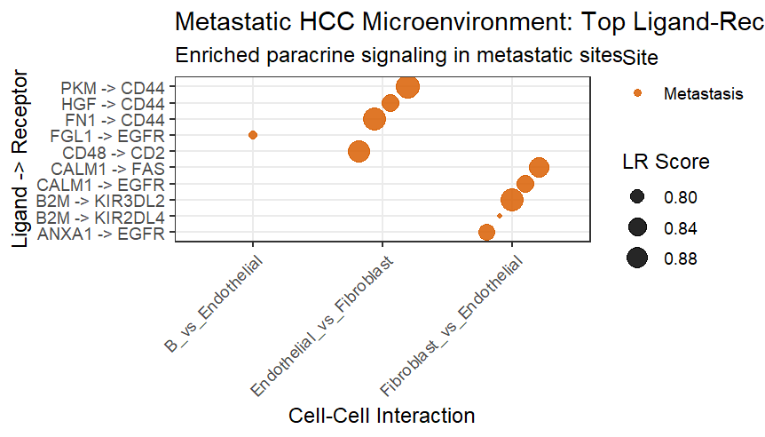
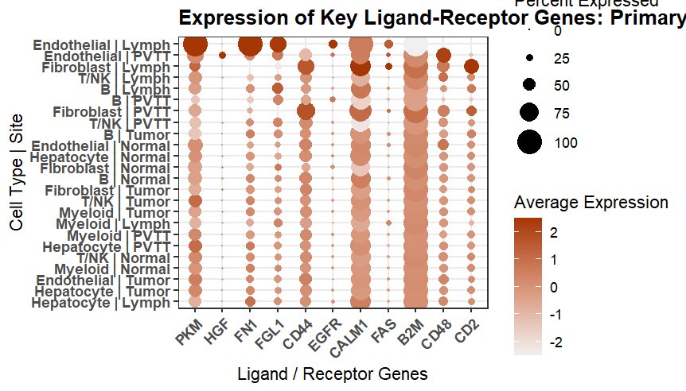
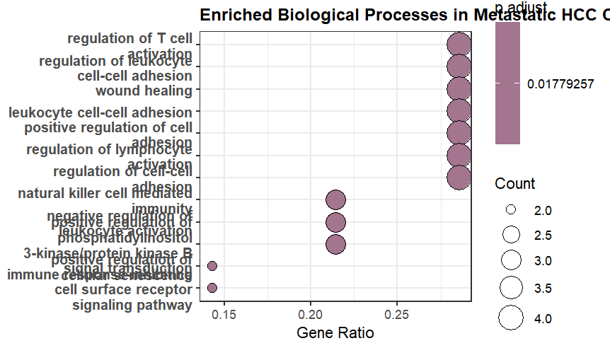

# Single-Cell RNA-seq Analysis of Hepatocellular Carcinoma (HCC) Metastasis

R · Seurat · DESeq2 · *Status: Completed* · *License: MIT*

*Author:* Zaina Mohamed (@ZainaElgammal)

## Overview

This repository contains my complete single-cell RNA-sequencing (scRNA-seq) analysis pipeline investigating how the tumor microenvironment changes during the metastatic spread of Hepatocellular Carcinoma (HCC).

The main goal of this project was to compare the cellular landscape of the *primary tumor (PT)* versus the metastatic niches — specifically the *portal vein tumor thrombus (PVTT)* and *lymph node metastases (MLN)* — to understand how cell composition and gene expression shift as HCC progresses.

I built this entire workflow from scratch using a standard *Seurat (R)* pipeline, starting from raw counts all the way to clustering, annotation, compositional analysis, and pseudobulk differential expression. All the data used here is publicly available and all results and figures were regenerated by my own code.

*Status:* ✅ Completed

## Data Source

- *Dataset:* [GEO accession GSE149614](https://www.ncbi.nlm.nih.gov/geo/query/acc.cgi?acc=GSE149614) — a published single-cell dataset of HCC patients with multiple tissue sites.
- *Tissue sites sampled:* Primary Tumor (PT / Tumor), Portal Vein Tumor Thrombus (PVTT), Metastatic Lymph Node (MLN / Lymph), and adjacent Normal liver tissue.
- *Starting size:* 71,915 cells × 25,712 genes (raw)
- *After QC:* 67,101 cells retained for downstream analysis

This dataset is quite large and heterogeneous, which is why the QC and filtering steps were critical before any clustering.

## Analysis Pipeline

### 1. Data Loading & Quality Control

- Raw count matrices (barcodes.tsv, genes.tsv) loaded into a Seurat object
- QC metrics calculated: nFeature_RNA, nCount_RNA, percent.mt
- Cells filtered on mitochondrial content (percent.mt < 10%) to remove stressed/dead cells
- Result: *67,101 high-quality cells* retained after QC
- Saved QC plot: 04_QC_violin.png

### 2. Normalization & Dimensionality Reduction

- NormalizeData for log-normalization of counts
- FindVariableFeatures — selected top 2,000 highly variable genes
- ScaleData and RunPCA — 30 principal components computed
- UMAP embedding computed on the PCA space for visualization
- Final UMAP saved as HCC_UMAP.png

### 3. Clustering & Cell-Type Annotation

I performed graph-based clustering (30 initial clusters) and then annotated them into *6 major cell populations* based on canonical marker genes. This was the most important part to make the data biologically meaningful.

| Cell Type | Description / Markers |
| :--- | :--- |
| *Hepatocyte* | Liver parenchymal / tumor epithelial cells (ALB, HNF4A, SERPINA1) |
| *T/NK* | T lymphocytes and NK cells |
| *Myeloid* | Monocytes / macrophages and other myeloid cells |
| *B* | B lymphocytes |
| *Endothelial* | Vascular endothelial cells |
| *Fibroblast* | Stromal fibroblasts |

Figures:
- 01_umap_by_celltype.png - UMAP of all 67,101 cells colored by annotated cell type
- 02_umap_by_tissue.png - Same UMAP colored by tissue site of origin (Tumor, PVTT, Lymph, Normal)

### 4. Compositional Analysis

To answer the main biological question — does cell composition change in metastasis?

- Per-patient cell-type proportions computed and compared between *PT vs Metastasis (PVTT + Lymph)* groups
- *Wilcoxon rank-sum test* run per cell type to assess significance of proportion shifts
- *Ratio of Observed to Expected (RO/E)* calculated per cell type, per tissue site, to quantify tissue-specific enrichment/depletion

Key observation from RO/E heatmap (07_RO_E_heatmap.png):
Hepatocytes were enriched in PVTT and Lymph (RO/E > 1), while T/NK were depleted in PVTT (0.53), suggesting an immune-excluded metastatic niche. Endothelial cells were strongly depleted in Lymph and PVTT compared to Tumor.

### 5. Marker Validation / Contamination Check

One challenge with this data is that finding hepatocytes in lymph nodes could be contamination. So I did a strict validation:

- Hepatocyte calls in PVTT and Lymph samples were cross-checked using canonical hepatocyte markers (*ALB, HNF4A, SERPINA1) against the immune marker **PTPRC (CD45)*, to rule out ambient RNA contamination or misclassification in non-liver tissue sites
- Violin plots confirm high ALB/SERPINA1 in Tumor and PVTT, with low PTPRC, supporting true metastatic hepatocytes
- Figure: 08_hepatocyte_marker_check.png

### 6. Differential Expression (Pseudobulk)

- *Pseudobulk DE analysis* performed on Hepatocyte cells only using *DESeq2*, aggregating counts at the patient level to avoid single-cell pseudoreplication
- Comparison: Metastasis (PVTT + MLN) vs Primary Tumor (PT)
- Results saved in 05_DE_pseudobulk_hepatocyte_...csv
- Volcano plot: 11_volcano_DE_hepatocyte_...png

No genes were significantly upregulated in metastasis at the applied significance threshold, which itself is an interesting biological finding — the metastatic hepatocytes are transcriptionally similar to primary ones, with changes driven more by microenvironment composition than intrinsic DE.

## Repository Structure

| File Name | Description |
| :--- | :--- |
| `LR-Analysis.R` | Ligand-receptor cell-cell communication analysis script |
| `LR-Genes-DotPlots.R` | Dot plot visualization script for ligand-receptor genes |
| `GO-Enrichment.R` | Gene Ontology (GO) functional enrichment analysis script |
| `barcodes.tsv` | Cell barcodes |
| `genes.tsv` | Gene features |
| `metadata.csv` | Cell-level metadata (cluster, cell type, tissue type, patient ID) |
| `HCC_UMAP.png` | UMAP colored by cluster |
| `01_umap_by_celltype.png` | UMAP colored by cell type |
| `02_umap_by_tissue.png` | UMAP colored by tissue origin |
| `04_QC_violin.png` | QC violin plots |
| `05_dotplot_markers.png` | DotPlot of canonical markers |
| `06_celltype_proportions_boxplot.png` | Boxplot of cell type proportions |
| `07_RO_E_heatmap.png` | RO/E enrichment heatmap |
| `08_hepatocyte_marker_check.png` | Hepatocyte marker validation |
| `11_volcano_DE_hepatocyte.png` | Volcano plot - hepatocyte DE (Met vs Primary) |
| `cluster_counts.csv` | Number of cells per cluster |
| `Cell_Proportions.csv` | Overall cell type proportions |
| `Top_Markers.csv` | Top markers per cluster |
| `01_celltype_proportions_PT_vs_Met.csv` | Cell type proportions PT vs Metastasis |
| `04_RO_E_celltype_by_site.csv` | RO/E score by tissue site |
| `05_DE_pseudobulk_hepatocyte.csv` | Pseudobulk DE results for hepatocytes |
| `LR-Analysis.R` | Ligand–receptor intercellular communication pipeline (`SingleCellSignalR`) |
| `LR-Genes-DotPlots.R` | Site-stratified expression validation of key ligand–receptor genes |
| `GO-Enrichment.R` | Gene Ontology (`GO:BP`) functional enrichment script (`clusterProfiler`) |
| `Metastasis_LR_interactions.csv` | Top inferred paracrine ligand–receptor pairs in metastatic lesions |
| `Metastatic_HCC_GO_Enrichment.csv` | Statistically enriched GO Biological Process terms (`BH` adjusted) |
| `Metastatic-HCC-LR-BubblePlot.png` | Bubble plot of top metastatic ligand–receptor interactions and LR scores |
| `HCC-LR-Genes-DotPlot.png` | Comparative DotPlot of key signaling genes across cell types and tissue sites |
| `Metastatic-HCC-GO-Enrichment.png` | DotPlot of top enriched biological processes in metastatic crosstalk |
---
### 7. Cell–Cell Communication & Ligand–Receptor Crosstalk (`SingleCellSignalR`)
To investigate how stromal, vascular, and immune compartments interact during metastatic progression, paracrine ligand–receptor signaling was inferred separately across primary tumor (`PT`) and metastatic lesions (`PVTT` + `MLN`) using `SingleCellSignalR` (`SCSRNoNet`, `min.logFC = 0.01`, `max.pval = 0.1`):

* **Key Finding:** Metastatic niches exhibited markedly enriched endothelial–fibroblast crosstalk compared to primary tumors, dominated by pro-invasive and ECM-remodeling axes (`PKM -> CD44`, `HGF -> CD44`, `FN1 -> CD44`, and `FGL1 -> EGFR`), alongside reciprocal fibroblast-to-endothelial (`CALM1 -> EGFR`, `CALM1 -> FAS`, `ANXA1 -> EGFR`, `B2M -> KIR3DL2/4`) and B-cell (`CD48 -> CD2`) signaling.
* **Expression Validation:** Site-stratified `DotPlot` profiling confirmed elevated expression of `PKM`, `HGF`, `FN1`, and `CD44` specifically within metastatic endothelial and fibroblast subsets (`PVTT` and `Lymph`), as well as `CD48`/`CD2` enrichment in lymphoid populations.

---

### 8. Functional Pathway Enrichment (`clusterProfiler`)
Over-representation analysis (ORA) of Gene Ontology Biological Processes (`GO:BP`, Benjamini–Hochberg adjusted $p < 0.05$) was performed on the top metastatic ligand–receptor gene set using `clusterProfiler` and `org.Hs.eg.db`:

* **Enriched Pathways:** Signaling genes converged significantly on **cell–cell adhesion**, **wound healing**, **regulation of T-cell activation**, and **natural killer (NK) cell-mediated immunity**, linking stromal remodeling with immune checkpoint/cytotoxic modulation in metastatic sites.

---

## Tools & Technologies
- **R / Seurat** - QC, normalization, PCA/UMAP, clustering
- **ggplot2** - all visualizations
- **DESeq2** - pseudobulk differential expression
- **SingleCellSignalR** — paracrine ligand–receptor interaction inference
* **clusterProfiler & org.Hs.eg.db** — Gene Ontology (`GO:BP`) functional enrichment

## How to Reproduce

1. Clone this repository
2. Run LR-Analysis.R and LR-Genes-DotPlots.R for ligand-receptor cell-cell communication analysis and site-stratified expression validation
3. Run GO-Enrichment.R for Gene Ontology (GO:BP) functional enrichment analysis and span analysis
4. Running the scripts regenerates the .csv result tables and .png figures listed above

## Author

*Zaina Mohamed* — Bioinformatics Student
GitHub: @ZainaElgammal
Project: scRNAseq-HCC-Metasis-Seurat

## Contact

For questions about this project, please open an issue in this repository.
